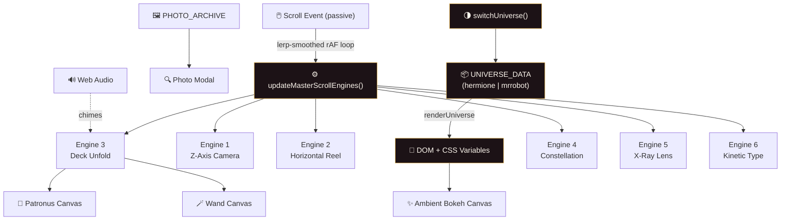

<div align="center">

<!-- Animated banner -->


<!-- Typing animation -->
<a href="https://github.com/YOUR_USERNAME/animatrd">
  
</a>

<br/>

[](https://YOUR_USERNAME.github.io/animatrd/)


<br/>
<sub>*"Books! And cleverness! There are more important things — friendship and bravery."*</sub>

</div>

---

## 📖 Table of Contents

- [✦ The Pitch](#-the-pitch)
- [🧙 The Six Engines](#-the-six-engines)
- [🌗 Dual Universe Mode](#-dual-universe-mode)
- [🔊 Synthesized Soundscape](#-synthesized-soundscape)
- [🏗️ Architecture](#%EF%B8%8F-architecture)
- [🛠️ Tech Stack](#%EF%B8%8F-tech-stack)
- [🚀 Quick Start](#-quick-start)
- [📁 Project Structure](#-project-structure)
- [⚡ Performance & Accessibility](#-performance--accessibility)
- [🗺️ Roadmap](#%EF%B8%8F-roadmap)
- [🎨 Design Decisions](#-design-decisions)
- [📜 Credits & Disclaimer](#-credits--disclaimer)
- [📄 License](#-license)

---

## ✦ The Pitch

> [!IMPORTANT]
> **Most character pages are walls of text. This one is a film.**
> Scroll becomes a camera, a timeline, a lens, and a typewriter. Every chapter is powered by its own hand-written animation engine, with **no React, no GSAP, no Three.js, no bundler** — just the platform, pushed as far as it will go.

This project is an **interactive cinematic chronicle** of Hermione Granger's complete story: her identity, backstory, magical profile, relationships, flaws, and legacy. It is built as one self-contained web page where **every scroll position is a deliberate piece of choreography**.

| | |
|---|---|
| 🎞️ **Format** | Single-page scroll-driven experience |
| ⚙️ **Engines** | 6 custom animation engines, each with a distinct interaction model |
| 🌗 **Themes** | 2 full "universes" with a live content, color, font, and imagery swap |
| 🖼️ **Media** | 11 curated photographs, SVG graphics, and live canvas simulations |
| 🔊 **Audio** | Procedurally generated ambience and spell chimes (no audio files) |
| 📦 **Footprint** | 1 HTML file + 1 image folder. Open it and it runs |

---


## 🧙 The Six Engines

Each chapter of the story is its own interaction paradigm. Expand a chapter to see how it works.

<details open>
<summary><b>🌀 Engine 01 — 3D Z-Axis Depth-of-Field Camera</b> &nbsp;·&nbsp; <i>Identity</i></summary>

<br/>

<div align="center">
</div>

Scrolling flies the viewer **through** a stack of layered planes along the Z-axis. Planes ahead are blurred and scaled down, the active plane snaps into sharp focus, and passed planes dissolve behind the camera, which creates a real **depth-of-field** effect.

- Seven planes: a hero intro, six "Arcana" trait cards, and a summary nexus
- Rotating geometric **astral portal** in the background (SVG)
- Scroll-driven blur, scale, and opacity per plane
- Live **engine HUD** that reports which engine is active

</details>

<details>
<summary><b>⏳ Engine 02 — Pinned Horizontal Time-Turner Chronicle</b> &nbsp;·&nbsp; <i>Chronicle</i></summary>

<br/>

<div align="center">
</div>

Vertical scrolling is converted into **horizontal cinema**. The stage pins to the viewport while a film reel of story milestones slides sideways.

- A **spinning SVG Time-Turner** whose rings rotate in sync with scroll
- An **odometer-style year counter** that rolls from 1979 onward
- A clickable **era scrubber** (`scrubToEra`) to jump to any point in her life
- Photographic milestones: the Yule Ball, Half-Blood Prince, and more

</details>

<details>
<summary><b>🔮 Engine 03 — 3D Deck Unfolding & Live Spell Simulators</b> &nbsp;·&nbsp; <i>Magic & Patronus</i></summary>

<br/>

<div align="center">

</div>

A bento-grid "origami deck" holds two **real-time canvas particle simulators**:

- 🦦 **Silver Otter Patronus**: a particle swarm that follows your cursor; press **Cast Expecto Patronum** for a radial burst
- 🪄 **Vine Wood Wand**: a glowing wand that emits sparks; press **Cast Lumos Maxima**
- Photo cards for her Gryffindor uniform and the Time-Turner prop open a **full-screen photo modal**

</details>

<details>
<summary><b>🌌 Engine 04 — Orbital Constellation Web</b> &nbsp;·&nbsp; <i>Nexus</i></summary>

<br/>

<div align="center">
</div>

Her relationships are drawn as a **living star map**. Hermione sits at the center, with Harry, Ron, Ginny, and the Trio orbiting her.

- Click any star to scroll its dossier into view, or scroll the dossiers to light up the matching star
- **Two-way sync** between the SVG graph and the scrolling card column
- Animated tether lines show the active connection

</details>

<details>
<summary><b>🔍 Engine 05 — Dual-Layer X-Ray Truth Lens</b> &nbsp;·&nbsp; <i>Flaws</i></summary>

<br/>

<div align="center">
</div>

Every card has a **surface reputation** and a **hidden truth**. Move your cursor across a card and a **mouse-tracked spotlight lens** (`bindXRayMouseSpotlight`) strips away the armor to reveal her real vulnerability. On touch devices, tap to lock the card open.

</details>

<details>
<summary><b>✍️ Engine 06 — Scroll-Scrubbed Kinetic Typography</b> &nbsp;·&nbsp; <i>Legacy</i></summary>

<br/>

<div align="center">
</div>

Her entire legacy is distilled into **one sentence** whose words illuminate one by one as you scroll, with key names and concepts highlighted in gold. Below it sits a **three-pathway deep-dive archive** with switchable drawers (`switchDeepDive`).

</details>

---

## 🌗 Dual Universe Mode

> [!TIP]
> Click **💻 Mr. Robot** in the top-right corner to rewrite the whole experience.

One toggle re-skins the entire site. A central `UNIVERSE_DATA` object drives **all copy, imagery, labels, and relationship nodes**, and CSS custom properties re-theme every surface.

<div align="center">

<br/>
  
</div>

<br/>

| | 🪄 Hermione | 💻 Mr. Robot |
|---|---|---|
| **Palette** | Gold `#e8b959`, amber, crimson | Neon red `#ff2a54`, cyan `#00f0ff` |
| **Display font** | Cinzel Decorative | Space Mono |
| **Narrative** | Magic, loyalty, rebellion | Hacking, fractured identity, fsociety |
| **Nodes** | Harry · Ron · Ginny · Trio | Darlene · Mr. Robot · Angela · Krista |
| **Glow** | Patronus cyan | Terminal green |

---

## 🔊 Synthesized Soundscape

There are **no audio files** in this repository. The ambience is generated live with the **Web Audio API**:

- 🎵 `startCelestialDrone()` / `stopCelestialDrone()` creates an evolving ambient drone from oscillators
- ✨ `playSpellChime(freq)` triggers a spell chime on interactions
- Audio is **off by default** and respects browser autoplay policy; toggle it with the `AMBIENCE` button in the nav

---

## 🏗️ Architecture



**One master loop, six engines.** A passive scroll listener records the target position, and a single `requestAnimationFrame` loop **eases** toward it (linear interpolation), then computes progress for each section and updates all six engines. The result is buttery, inertial motion without per-event layout work. Content is **data-driven**: swapping a universe is just re-rendering from a different object.

---

## 🛠️ Tech Stack

| Layer | Technology | Why |
|---|---|---|
| Structure | **Semantic HTML5** | Accessible landmarks (`header`, `nav`, `section`, `footer`) |
| Styling | **CSS3**: custom properties, `clamp()`, `backdrop-filter`, `mix-blend-mode`, grid, `position: sticky` | Theming and fluid type with no preprocessor |
| Logic | **Vanilla ES6+ JavaScript** | Full control, zero bundle weight |
| Graphics | **Canvas 2D** and **inline SVG** | Particles, bokeh, Time-Turner, constellation |
| Audio | **Web Audio API** | Procedural sound with no assets |
| Typography | Google Fonts: *Cinzel Decorative*, *Cormorant Garamond*, *Plus Jakarta Sans*, *Space Mono* | Cinematic editorial feel |

---

## 🚀 Quick Start

> [!NOTE]
> No `npm install`. No build. No server required.

**Option 1: just open it**

```bash
git clone https://github.com/YOUR_USERNAME/animatrd.git
cd animatrd/animatrd
open index.html        # macOS
# start index.html     # Windows
# xdg-open index.html  # Linux
```

**Option 2: run a local server (recommended)**

```bash
cd animatrd
python3 -m http.server 8000
# → http://localhost:8000
```

**Option 3: deploy free on GitHub Pages**

1. Push the repo to GitHub
2. Go to **Settings → Pages**
3. Under *Build and deployment*, choose **Deploy from a branch**, then select `main` and the folder containing `index.html`
4. Your site goes live at `https://YOUR_USERNAME.github.io/animatrd/`

<details>
<summary>💡 <b>Tips for the best experience</b></summary>

- Use a **desktop browser** at 1280px or wider; the scroll engines shine on a large viewport
- Turn on **AMBIENCE** for the full atmosphere (sound starts after your first click)
- Try the **Mr. Robot** toggle midway through the page
- Hover the **X-Ray cards** in Chapter 5, then move your cursor around the Patronus chamber in Chapter 3

</details>

---

## 📁 Project Structure

```text
animatrd/
├── 📄 index.html          # The entire experience: markup, styles, 6 engines, data
└── 🖼️ images/
    ├── hermione_hero.jpg
    ├── hermione_costume.jpg
    ├── hermione_yule_ball.jpg
    ├── hermione_hbp.jpg
    ├── hermione_trio.jpg
    ├── hermione_wand.jpg
    ├── hermione_portrait_alt.jpg
    ├── hermione_wb_mannequin.jpg
    ├── emma_watson_premiere.jpg
    ├── hogwarts_library.jpg
    └── time_turner.jpg
```

<details>
<summary>🔎 <b>Where to find things in <code>index.html</code></b></summary>

| Concern | Look for |
|---|---|
| Theme tokens (colors, fonts) | `:root[data-theme="hermione"]` / `"mrrobot"` |
| All story content | `UNIVERSE_DATA` |
| Photo modal content | `PHOTO_ARCHIVE` |
| Universe switching | `renderUniverse()` and `switchUniverse()` |
| Master scroll loop | `updateMasterScrollEngines()` |
| Spell simulators | `animateSpellSimulators()`, `triggerPatronusBurst()`, `triggerWandSparks()` |
| Ambient background | `initBokehOrbs()`, `animateGlobalAtmosphere()` |
| Audio | `toggleAtmosphericAudio()`, `startCelestialDrone()`, `playSpellChime()` |

</details>

---

## ⚡ Performance & Accessibility

- ✅ **One rAF loop** with lerp-smoothed scroll drives every engine, and the scroll listener is `passive`
- ✅ **No third-party JS**, so there is nothing to download or parse beyond the page itself
- ✅ `overflow-x: clip` prevents horizontal scroll bleed
- ✅ Semantic landmarks and an `aria-label` on chapter navigation
- ✅ Descriptive `alt` text on photographs
- ✅ Audio is opt-in and never autoplays

<details>
<summary>📊 <b>Planned optimizations</b></summary>

- [ ] Re-encode the largest images as WebP/AVIF with responsive `srcset`, since the hero photo is the heaviest asset
- [ ] Lazy-load below-the-fold images with `loading="lazy"`
- [ ] Add a `prefers-reduced-motion` mode that disables parallax and particles
- [ ] Add keyboard-operable controls for the X-Ray cards

</details>

---

## 🗺️ Roadmap

- [x] Engine 1: 3D Z-axis depth-of-field camera
- [x] Engine 2: Pinned horizontal Time-Turner chronicle
- [x] Engine 3: Live Patronus and wand particle simulators
- [x] Engine 4: Orbital constellation with two-way sync
- [x] Engine 5: X-Ray truth lens
- [x] Engine 6: Kinetic scroll-scrubbed typography
- [x] Dual-universe theming (Hermione ↔ Mr. Robot)
- [x] Procedural Web Audio soundscape
- [ ] `prefers-reduced-motion` support
- [ ] WebP/AVIF image pipeline
- [ ] Third universe (a new theme drops in with one `UNIVERSE_DATA` entry)
- [ ] Mobile-first gesture layer

---

## 🎨 Design Decisions

<details>
<summary><b>Why vanilla JavaScript?</b></summary>

Libraries like GSAP and Three.js are excellent, but a core goal here was to show what the raw platform can do. Writing every engine by hand means total control over timing, zero dependency risk, and a page that opens instantly from a single file.

</details>

<details>
<summary><b>Why data-driven universes?</b></summary>

Keeping all content in `UNIVERSE_DATA` separates **story** from **mechanics**. Adding a new universe means adding one object; no engine code changes.

</details>

<details>
<summary><b>Why a different interaction per chapter?</b></summary>

Each section's *content* has a natural *metaphor*: depth for identity, a horizontal reel for time, particles for magic, orbits for relationships, a lens for hidden truths, and typography for legacy. The interaction **is** the storytelling.

</details>

---

## 📜 Credits & Disclaimer

> [!WARNING]
> This is a **non-commercial fan and educational project**. It is **not affiliated with, endorsed by, or sponsored by** Warner Bros. Entertainment, J.K. Rowling, Wizarding World, or the creators of *Mr. Robot*.

- *Harry Potter* characters, names, and related indicia are trademarks of and © **Warner Bros. Entertainment Inc.** / **J.K. Rowling**
- *Mr. Robot* is © **Universal Content Productions** / **Sam Esmail**
- Photographs are credited to their original photographers and rights holders and are used for **illustrative, non-commercial purposes**; replace or remove any image on request
- Fonts via [Google Fonts](https://fonts.google.com/) (SIL Open Font License)
- README badges by [Shields.io](https://shields.io), banner by [capsule-render](https://github.com/kyechan99/capsule-render), typing animation by [readme-typing-svg](https://github.com/DenverCoder1/readme-typing-svg)

**Built by [@YOUR_USERNAME](https://github.com/YOUR_USERNAME)**[^1]

[^1]: Created as a competition entry to explore how far a single HTML file can go as a cinematic storytelling medium.

---

## 📄 License

The **source code** is released under the MIT License. Third-party media and trademarks remain the property of their respective owners (see above).

<div align="center">

<br/>

**If this made you smile, drop a ⭐ — it's the closest thing to a Time-Turner for getting more visibility.**

<br/>


<sub>✦ *Mischief managed.* ✦</sub>

</div>
